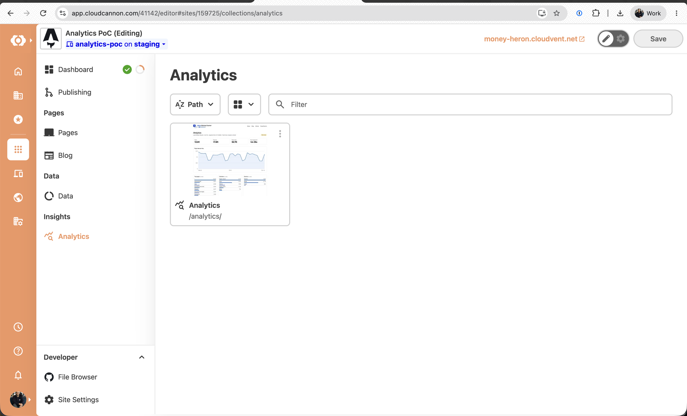
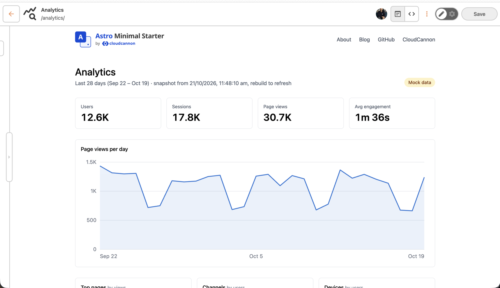
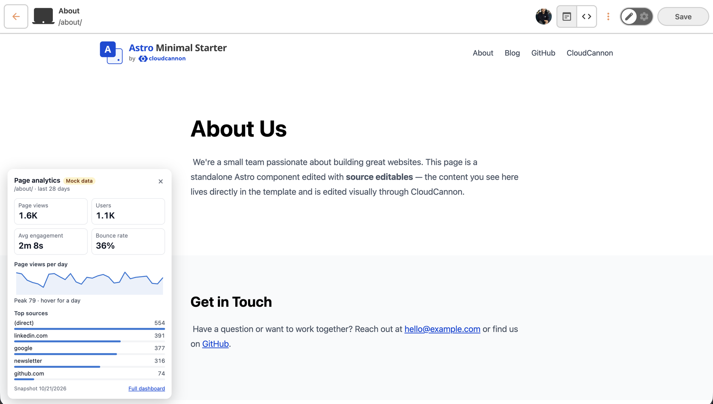

# Analytics in CloudCannon's Visual Editor (PoC)

Shows Google Analytics (GA4) data to editors inside CloudCannon, without exposing it or the GA credentials to site visitors.

- **Per-page pop-up**: a collapsible panel in the bottom-left corner of every page opened in the Visual Editor. It shows that page's views, users, average engagement time, bounce rate, a daily trend and top sources.
- **Dashboard**: `/analytics/`, opened from **Insights → Analytics** in the CloudCannon sidebar. It shows site totals, a daily trend, top pages, channels, devices and a table of every page.

## Screenshots

The screenshots show mock data.

The **Insights → Analytics** entry in the CloudCannon sidebar:



The dashboard, open in the Visual Editor:



The pop-up on a page open in the Visual Editor:



## How it works

CloudCannon environment variables exist only during the build. Nothing in the Visual Editor can read them, and CloudCannon hosting runs no server-side code. So the GA credentials are used at build time and never reach the browser.

The setup uses two CloudCannon sites from the same repository:

- **Production** carries the GA4 tracking tag and collects visits. It builds no analytics pages.
- **Staging** reads the collected data from the GA4 Data API during its build and writes a snapshot. Editors work here, and the whole site sits behind CloudCannon authentication.

On a build with `ANALYTICS_ENABLED`:

1. `src/lib/analytics.ts` fetches the last 28 days (ending yesterday) from the GA4 Data API, signed in as a Google Cloud service account.
2. `src/pages/analytics/[...path].astro` renders the snapshot as the `/analytics/` dashboard, and `src/pages/analytics/[file].json.ts` writes per-page numbers to `/analytics/pages.json`. Both contain aggregated numbers only.
3. `src/scripts/analytics-panel.ts` loads only when `window.inEditorMode` is set, which CloudCannon does inside the Visual Editor. It reads `/analytics/pages.json` and shows the numbers for the current path. If the file is missing, it shows nothing.

Without `ANALYTICS_ENABLED`, neither file is built and `/analytics/` returns a 404. The data is as fresh as the last staging build.

The pop-up only reads data, so it needs no Visual Editor API calls. The **Insights → Analytics** sidebar entry comes from the `analytics` collection in `cloudcannon.config.yml`, which points at the stub file `analytics/index.md`.

## Files

| File                                           | Role                                                                      |
| ---------------------------------------------- | ------------------------------------------------------------------------- |
| `src/lib/analytics.ts`                         | Fetches the GA4 report at build time, or generates mock data              |
| `src/pages/analytics/[...path].astro`          | The `/analytics/` dashboard                                               |
| `src/pages/analytics/[file].json.ts`           | `/analytics/pages.json`, the pop-up's data                                |
| `src/scripts/analytics-panel.ts`               | The editor-only pop-up, with no dependencies                              |
| `src/layouts/Layout.astro`                     | Loads the pop-up in the Visual Editor, and the gtag snippet on production |
| `astro.config.mjs`                             | Declares the environment variables, and marks `GA_CREDENTIALS` as secret  |
| `cloudcannon.config.yml`, `analytics/index.md` | The **Insights → Analytics** sidebar entry                                |

## Setup

You need a CloudCannon account, a Google account with access to Google Analytics, and access to Google Cloud.

### 1. Create the CloudCannon sites

1. Create the production site from this repository's main branch.
2. Create the staging site from a separate branch of the same repository.
3. On the staging site, go to **Site Settings → Authentication** and choose **CloudCannon** or **Password**, so the dashboard and `pages.json` stay private.

The Visual Editor keeps working behind staging authentication.

### 2. Create the GA4 property

1. In [Google Analytics](https://analytics.google.com), open an account, or create one. Then go to **Admin → Create → Property**.
2. Add a **Web** data stream for the production URL, with **Enhanced measurement** left on.
3. Note the **measurement ID** (`G-XXXXXXXXXX`), shown on the data stream.
4. Note the numeric **property ID**, shown in **Admin → Property details**. The two IDs are easy to mix up: the measurement ID is for tracking, the property ID is for reading.
5. Leave **Google signals** off (**Admin → Data collection**). With it on, GA hides small numbers in reports, which leaves gaps on low-traffic sites.

The PoC uses only the dimensions and metrics GA4 collects by default, so the property needs no custom events or custom dimensions.

### 3. Track production

1. On the production site, go to **Site Settings → Build configuration → Environment Variables**. Add `GA_MEASUREMENT_ID` with the `G-` ID, then rebuild.
2. Open the live site in a normal browser tab. Your visit should appear in GA under **Reports → Realtime** within a minute or so.

`src/layouts/Layout.astro` adds the gtag snippet only when `GA_MEASUREMENT_ID` is set. The snippet skips the Visual Editor, which can load production pages too, so editors' previews don't count as visits.

Keep the measurement ID off staging. The URL on a GA data stream doesn't filter anything: any page carrying the ID reports to the property.

### 4. Give the build read access

The staging build reads GA as a Google Cloud service account, using its JSON key.

1. In the [Google Cloud console](https://console.cloud.google.com), create or pick a project. It doesn't need a billing account.
2. Go to **APIs & Services → Library**, find **Google Analytics Data API**, and click **Enable**.
3. Go to **IAM & Admin → Service Accounts → Create service account**, and give it a name such as `analytics-reader`. Skip the optional step that grants it access to the project.
4. Open the service account, go to **Keys → Add key → Create new key → JSON**. A key file downloads. Leave it outside the repository, for example in `~/Downloads`.
5. Copy the service account's email address (`<name>@<project>.iam.gserviceaccount.com`).
6. In GA, go to **Admin → Property access management → + → Add users**. Paste the email, choose the **Viewer** role, and untick the email notification.

The key file contains a private key, so treat it like a password. Never commit it. Store it in a password manager or delete it once it's in CloudCannon. If it leaks, delete it under the service account's **Keys** tab and create a new one. Viewer access means a leaked key can read this one property, but not change it.

### 5. Point staging at GA

1. Base64-encode the key, so it fits on one line:

   ```bash
   base64 -i ~/Downloads/<key-file>.json | pbcopy
   ```

2. On the staging site, go to **Site Settings → Build configuration → Environment Variables** and add:

   | Key                 | Value                                |
   | ------------------- | ------------------------------------ |
   | `ANALYTICS_ENABLED` | `true`                               |
   | `GA_PROPERTY_ID`    | The numeric property ID from step 2  |
   | `GA_CREDENTIALS`    | The base64 key (raw JSON also works) |

3. Wait until GA has collected at least a day of data. A new property shows nothing for 24–48 hours.
4. Rebuild staging.
5. Open **Insights → Analytics** on the staging site. The dashboard shows real numbers and no **Mock data** badge. Then open any page in the Visual Editor and check that the pop-up appears in the bottom-left corner.

With `ANALYTICS_ENABLED` set but either GA variable missing, the build uses generated mock data and labels it **Mock data**.

A site branched or duplicated from another copies its environment variables. Check each site has only its own:

- **Production:** `GA_MEASUREMENT_ID` only. If production keeps the staging variables, it publishes the dashboard and `pages.json` with no login.
- **Staging:** `ANALYTICS_ENABLED`, `GA_PROPERTY_ID` and `GA_CREDENTIALS` only.

A build with both `ANALYTICS_ENABLED` and `GA_MEASUREMENT_ID` set fails on purpose, since that combination means the analytics pages are about to be built on production.

### Environment variable reference

| Key                 | Site       | In the built site | Purpose                                     |
| ------------------- | ---------- | ----------------- | ------------------------------------------- |
| `GA_MEASUREMENT_ID` | Production | Yes               | Adds the gtag tracking snippet              |
| `ANALYTICS_ENABLED` | Staging    | No                | Builds `/analytics/` and the pop-up's data  |
| `GA_PROPERTY_ID`    | Staging    | No                | The GA4 property the build reads            |
| `GA_CREDENTIALS`    | Staging    | No                | Service account key the build signs in with |

The measurement ID is public by design: the tag can't work without it in the page source, and it can only send data in, not read it out.

`GA_CREDENTIALS` is the only real secret. `astro.config.mjs` declares both it and `GA_PROPERTY_ID` with `access: "secret"`, so Astro reads them at build time and never writes them into the built site.

## Adding it to your own site

The site around the analytics is a minimal Astro starter, so the analytics pieces are easy to lift out. For an Astro site:

1. Install the GA4 Data API client:

   ```bash
   npm install @google-analytics/data
   ```

2. Copy `src/lib/analytics.ts`, `src/pages/analytics/` and `src/scripts/analytics-panel.ts`.
3. Copy the `env.schema` block from `astro.config.mjs`.
4. In your base layout, copy two things from `src/layouts/Layout.astro`: the `analytics-panel.ts` import inside the `window.inEditorMode` check, and the `GA_MEASUREMENT_ID` gtag snippet in `<head>`.
5. Copy the `analytics` collection and its `collection_groups` entry from `cloudcannon.config.yml`, and the stub file `analytics/index.md`.
6. Adjust two things to your site:
   - `sitePaths()` in `src/lib/analytics.ts` lists page URLs for the mock data from this site's `pages` and `blog` collections. Point it at your own collections.
   - The dashboard page uses this site's `Layout.astro` and Tailwind classes. Swap in your own layout and styles.

`analytics-panel.ts` is framework-free and styles itself inside a shadow root, so it works unchanged on any site. On another static site generator, keep the same shape: a build step that writes `/analytics/pages.json` and the dashboard page only when `ANALYTICS_ENABLED` is set, and the pop-up script loaded behind `window.inEditorMode`.

## Running it locally

```bash
npm install
ANALYTICS_ENABLED=true npm run dev
```

The dashboard is at [localhost:4321/analytics/](http://localhost:4321/analytics/), with mock data. To use real data, put the staging variables in a `.env` file (gitignored) instead.

The pop-up only loads in the Visual Editor. To see it locally, build the site and run it in CloudCannon with the [CloudCannon CLI](https://cloudcannon.com/documentation/developer-reference/cli/) (Node.js 24+):

```bash
npm install --global @cloudcannon/cli
cloudcannon login
ANALYTICS_ENABLED=true npm run build
cloudcannon dev dist
```

## Troubleshooting

- **Dashboard shows "Mock data" on staging:** `GA_PROPERTY_ID` or `GA_CREDENTIALS` is missing from the staging site. The build log says `[analytics] GA_PROPERTY_ID or GA_CREDENTIALS not set, using mock data`.
- **Build fails with `ANALYTICS_ENABLED and GA_MEASUREMENT_ID are both set`:** one site has both production and staging variables. Remove the ones that belong to the other site (step 5).
- **Staging build fails with `GA4 request failed: gRPC 7: …`:** a permission error. The service account isn't a Viewer on the property, or `GA_PROPERTY_ID` holds the `G-` measurement ID instead of the numeric property ID.
- **Staging build fails with a `GA4 request failed` message saying the API is disabled or hasn't been used:** enable the Google Analytics Data API in the service account's Cloud project.
- **Staging build fails with `GA_CREDENTIALS is not valid service account JSON` or `is missing client_email or private_key`:** the key was cut short or changed when pasted. Re-copy the base64 output in full.
- **Staging build fails with `the Google client failed before reaching the API`:** the key parsed, but signing in failed. Usually the key was deleted or isn't a valid private key; a network failure during the build gives the same message. Rebuild once, then create a new key if it persists (step 4). The log leaves out the underlying error, because it can quote the key.
- **Can't create a service account key:** your Google Cloud organisation has a policy blocking service account keys. Ask an organisation admin to allow it for the project, or use a project outside the organisation.
- **Dashboard shows zeros:** the property is new, or production has no `GA_MEASUREMENT_ID`. Check **Reports → Realtime** in GA, then rebuild staging a day later.
- **No pop-up in the Visual Editor:** `/analytics/pages.json` doesn't exist on that site. The browser console logs `[analytics] /analytics/pages.json returned 404`. Set `ANALYTICS_ENABLED` and rebuild.
- **`/analytics/` is public:** turn on authentication for the staging site (step 1).

## Costs and limits

- Standard GA4 and the GA4 Data API are free. The Data API has daily quotas per property instead of billing, and each staging build makes six requests. Only calls signed with your service account key count toward the quota.
- Any site can send hits with your measurement ID, which adds junk to the data but can't cost money. Every hit records the domain it came from in the `hostName` dimension, which you can filter on in GA reports.
- The data only refreshes when staging rebuilds.
- The **Insights → Analytics** sidebar entry also appears on production, because `cloudcannon.config.yml` is shared across branches. There it shows a `No Preview Available` and won't open, because no `/analytics/` page builds on production.
